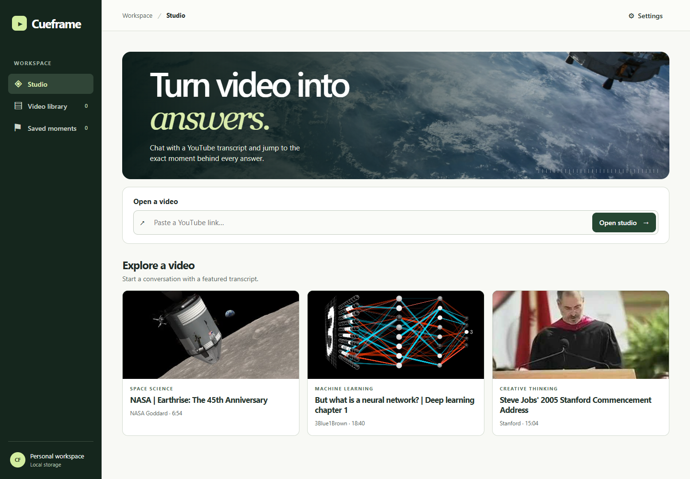

# Cueframe

**Ask a YouTube video a question and jump to the captions behind its answer.** Cueframe is a local retrieval-augmented generation (RAG) app for researching captioned videos. It supports follow-up questions, saved passages, and Markdown notes with playable citations. Inference runs on the user's machine through Ollama.

## A conversation you can verify

In *7 Daily Tasks Every Data Engineer Actually Does*, the instructor introduces two technology tracks. These results come from a run against the video's captions.

| Question | Answer, condensed | Supporting passage |
| --- | --- | --- |
| Which two technology tracks does the instructor cover? | Data engineering on Databricks and Google Cloud. | [0:25–0:36](https://youtu.be/ozaiDRsEbWQ?t=25) |
| What was the second one? | Data engineering on Google Cloud. | [0:29–0:36](https://youtu.be/ozaiDRsEbWQ?t=29) |

The second question contains neither platform name. Cueframe uses the recent conversation for that video and caption language to resolve the reference, then checks the transcript for evidence.

For a **no-install preview**, download and open the [standalone HTML demo](docs/demo.html). It searches a bundled sample transcript. The Python studio below runs the full conversational pipeline.

## How an answer gets its timestamp

1. **Ingest.** Fetch YouTube captions and group neighboring lines into overlapping passages. Each passage retains the character offsets and playback times of its original captions.
2. **Retrieve.** Rewrite follow-ups using up to three recent turns. Combine LangChain vector search over local `nomic-embed-text` embeddings with keyword ranking so paraphrases and exact technical names can both surface relevant passages.
3. **Answer.** An optional RoBERTa reader extracts factual spans and scores them against its no-answer prediction. For questions that need synthesis, `qwen2.5:3b` receives ranked passages and reader hints.
4. **Cite.** Map supporting text back to its caption range. Selecting the timestamp seeks the embedded player. SQLite stores videos, conversations, and bookmarks locally.

Caption availability and transcription errors affect retrieval. A matching quote identifies where the evidence came from. The player and transcript let the reader check whether it supports the model's interpretation.

## Run locally

Use Python 3.11 or 3.12. Create and activate a virtual environment from the repository root.

~~~sh
python -m venv .venv
~~~

On Windows PowerShell, use `.\.venv\Scripts\Activate.ps1`. On macOS or Linux, use `source .venv/bin/activate`. Then install the dependencies.

~~~sh
python -m pip install -r requirements.txt
~~~

For conversational answers, install and start [Ollama](https://ollama.com/download), then download the models. The optional reader adds about 500 MB.

~~~sh
ollama pull nomic-embed-text
ollama pull qwen2.5:3b
python reader.py
~~~

~~~sh
python studio.py
~~~

Open [Cueframe Studio](http://127.0.0.1:8501), paste a captioned YouTube URL, and ask a question. **Settings → Keyword excerpt search** also works without model downloads. The first conversational question builds the video's index and can take over a minute on a CPU.

The server binds to loopback. `CUEFRAME_PORT` selects the port and `CUEFRAME_DATA_DIR` overrides the default SQLite directory, `~/.cueframe`.

## Code and verification

| Location | Responsibility |
| --- | --- |
| [studio.py](studio.py) | Local HTTP API, transcript ingestion, SQLite storage, and conversation history |
| [rag.py](rag.py) | Chunking, hybrid retrieval, contextual answers, and citation alignment |
| [reader.py](reader.py) | Checksum-verified model installation and CPU inference with ONNX Runtime |
| [web/](web/) | Browser workspace, transcript search, player, bookmarks, and export |
| [tests/](tests/) | Retrieval, follow-ups, citation timing, history isolation, and persistence |

Run `python -m unittest discover -v`. The automated suite uses fixtures and model test doubles, so it can run without Ollama or YouTube access. GitHub Actions runs the same command on pushes and pull requests.

The studio uses an [orbital photograph](https://images.unsplash.com/photo-1446776811953-b23d57bd21aa) and official thumbnails for the featured YouTube videos.
