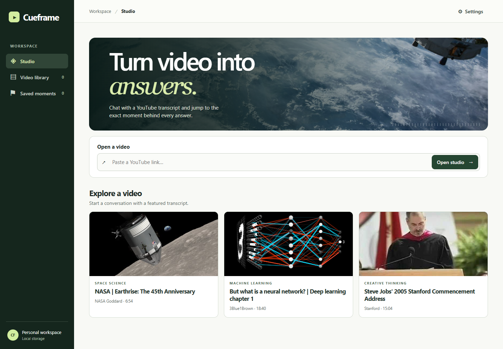

# Cueframe

A local video research workspace. Paste a YouTube link, ask a question, and click the cited timestamp to play that moment. No hosted service or OpenAI key is required.



## Run the studio

Use Python 3.11 or 3.12. From this repository:

```sh
python -m venv .venv
```

Windows PowerShell:

```powershell
.\.venv\Scripts\python -m pip install -r requirements.txt
.\.venv\Scripts\python studio.py
```

macOS or Linux:

```sh
.venv/bin/python -m pip install -r requirements.txt
.venv/bin/python studio.py
```

Open [Cueframe on localhost](http://127.0.0.1:8501). Paste a link or open one of the featured videos. The server binds to the loopback address. Set `CUEFRAME_PORT` to choose another port.

## Work with a video

- **Ask a question.** Excerpt mode ranks timestamped transcript passages and displays the speaker's words. It uses lexical matching, so specific terms work best.
- **Check the source.** Click the green time range to seek the embedded player. Search the transcript and click a caption to hear it in context. Videos with embedding restrictions can be opened on YouTube.
- **Save a moment.** Bookmark an answer's evidence, then return to its timestamp from Saved moments.
- **Resume your research.** The library retains transcripts, chat history, and saved moments in SQLite at `~/.cueframe/workspace.sqlite`. Override the directory with `CUEFRAME_DATA_DIR`. This is a single-user local workspace.
- **Export notes.** Download the conversation and bookmarks as Markdown with timestamped YouTube links.
- **Choose a caption language.** Open Settings before importing a video. English is the fallback. Live ingestion requires accessible YouTube captions and internet access.

## Enable local AI generation

Install [Ollama](https://ollama.com/download), start it locally and download both models:

```sh
ollama pull nomic-embed-text
ollama pull qwen2.5:3b
```

Select **Settings → Answer mode → Local AI**. On the first AI question, the server embeds overlapping caption chunks and builds a LangChain in-memory vector index. The retriever selects up to four passages, and the local chat model generates statements with exact supporting quotes. Cueframe checks each quote against its referenced passage and attaches the caption range containing the quoted words. A quote match verifies that the words appear in the transcript. Use the timestamp to assess the model's interpretation.

## Demo and tests

The featured videos use real captions. For a standalone preview without installing Python, open **demo.html**, which searches an original bundled sample. The earlier Streamlit interface remains available via `python -m streamlit run app.py` on a free port.

Run `python -m unittest -v` inside the environment. Tests cover retrieval, citation timing, local persistence and the Streamlit compatibility interface. The model tests use test doubles.

## Media

The studio's [orbital photograph](https://images.unsplash.com/photo-1446776811953-b23d57bd21aa) is served locally. Featured cards use their videos' YouTube thumbnails, titles, and channel names.
