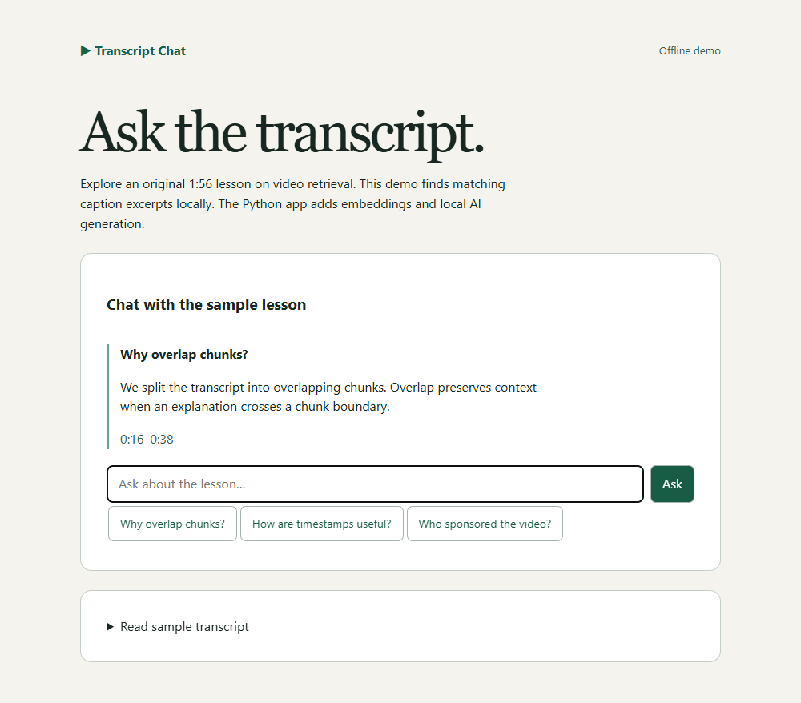

# YouTube RAG Chatbot

Ask questions about a captioned YouTube video. Each answer includes a transcript excerpt and a timestamp link so you can check what the speaker said. Embeddings and generation run on your machine through Ollama.



## Try the offline demo

Download or clone this repository and open **demo.html** in a browser. Ask **Why overlap chunks?** to see the excerpt at **0:16**, then ask **Who sponsored the video?** to see the missing-evidence response. The standalone preview uses word matching over an original sample transcript and works without installation.

## Run the full RAG chatbot

Install Python 3.11 or 3.12 and [Ollama](https://ollama.com/download). Start Ollama and download the two models once. Model downloads require internet access and local disk space.

```sh
ollama pull nomic-embed-text
ollama pull qwen2.5:3b
python -m venv .venv
```

On Windows PowerShell:

```powershell
.\.venv\Scripts\python -m pip install -r requirements.txt
.\.venv\Scripts\python -m streamlit run app.py --server.address 127.0.0.1
```

On macOS or Linux:

```sh
.venv/bin/python -m pip install -r requirements.txt
.venv/bin/python -m streamlit run app.py --server.address 127.0.0.1
```

Open the local URL printed by Streamlit. Click **Index transcript** with an empty URL to use the sample, or paste a YouTube link and enter a caption language code. Ask a question and expand **Transcript evidence** to inspect its source. Indexing a new video starts a fresh conversation.

## How an answer is produced

1. **Ingest** captions from YouTube with their start times and durations. English is the fallback for the requested caption language.
2. **Chunk** neighboring captions into passages targeting 45 seconds and 900 characters. Adjacent passages overlap by one caption where possible.
3. **Embed and index** the passages with local `nomic-embed-text` embeddings and LangChain's in-memory vector store.
4. **Retrieve** up to four passages by cosine similarity. Short follow-ups include the previous question in the search query.
5. **Generate** evidence-backed statements with local `qwen2.5:3b`. Each statement must reference a retrieved passage and quote its text. The app drops invalid citations and shows an insufficient-evidence response when none survive.

The quote check verifies that cited words appear in a retrieved passage. The reader can use the excerpt to judge whether it supports the generated claim. Jump links point to the start of the passage. Indexes and chat history live in the Streamlit session. Remote videos require accessible captions and a connection to YouTube, which may restrict transcript requests. The sample works offline after setup.

## Tests

Run `python -m unittest -v` inside the project environment. The tests exercise video URL parsing, citation validation and the Streamlit sample workflow with model test doubles.
